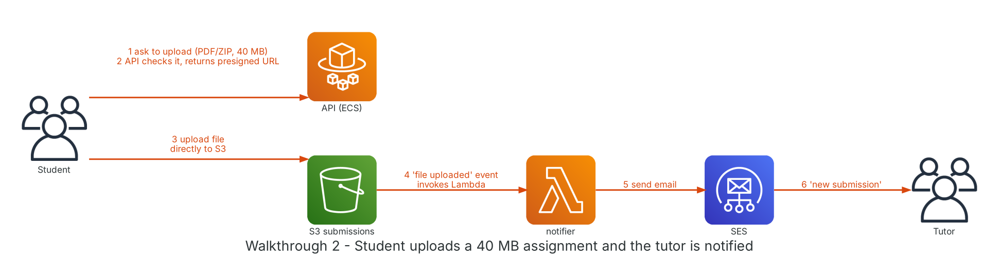

# Task 1: Architecture Design

## 1. The design in one paragraph

Students and tutors open the site through **Route 53** (DNS) and **CloudFront** (CDN), with **WAF** blocking bad traffic. The website itself is a React app stored in **S3**, and users sign in with **Cognito**. All API calls go to a **load balancer** in the public subnets. It sends them to the **API running on ECS Fargate** in private subnets, and the API stores everything in an **RDS PostgreSQL** database. The database has a primary copy in one Availability Zone and a standby in the other. Assignment files go straight from the browser into an **S3 bucket**. Slow background jobs run in **Lambda** functions: exam marking goes through an **SQS queue**, and uploads trigger an email Lambda directly. Emails are sent with **SES**. Everything runs in **two Availability Zones**, so the platform keeps working if one fails.

### **Architecture diagram**

## 2. Components (what each layer is for)

| Layer | Services | What it does |
|---|---|---|
| Edge | Route 53, CloudFront, WAF | DNS name, fast global delivery over HTTPS, blocks attacks and floods |
| Frontend | S3 (website bucket) | Holds the React app; only CloudFront can read it |
| Authentication | Cognito | Sign-in with three roles: student, tutor and admin |
| Network | VPC with public, private-app and private-DB subnets in AZ-a and AZ-b; Internet gateway; one NAT gateway per AZ | Only the load balancer is public. The API and database have no public IP. |
| API / compute | Application Load Balancer, ECS Fargate (tasks in both AZs) | Runs the exam API and scales up before exams |
| Database | RDS PostgreSQL Multi-AZ (primary + standby) | Users, exams, answers and results. Every write is copied instantly to the standby. |
| File storage | S3 submissions bucket | Encrypted; lifecycle rules move files to Standard-IA after 90 days and Glacier after 1 year, and delete them after 5 years |
| Async processing | SQS marking-queue → Lambda auto-marker; S3 upload event → Lambda notifier → SES | Marks MCQs and sends emails without slowing the API |
| Security | Security groups, Secrets Manager, KMS | Each tier only accepts traffic from the tier in front of it; the DB password is kept secret; all data is encrypted |
| Monitoring and backup | CloudWatch, AWS Backup | Logs and alarms; database backups kept for 5 years |
| CI/CD | GitHub Actions, ECR | A push to `main` tests, builds and redeploys automatically |

**Security groups chain each tier:**

| Security group | Allows |
|---|---|
| `alb-sg` | 443 from the internet |
| `app-sg` | 8080 from `alb-sg` only |
| `db-sg` | 5432 from `app-sg` only |

## 3. Walkthrough 1: A student opens an exam and answers autosave

1. The student signs in with **Cognito** and gets a token with the role *student*.
2. The browser opens `exams.uni.edu`. **Route 53** points it to **CloudFront**, and **WAF** checks the request.
3. CloudFront sends `/api/*` requests to the **load balancer**.
4. The load balancer passes the request to a healthy **API task (ECS)**. The API checks the token and the exam time, then returns the questions.
5. Every **30 seconds** the browser sends the answers, and the API saves them in **RDS**.
6. RDS **instantly copies** each save to the standby in the other AZ, so no saved answer is lost.
7. When the student submits, the API adds a job to the **marking-queue**, and a **Lambda** marks the MCQs.

**Simulation in the Cloud Architecture Lab:** the request passes Route 53 → CloudFront → Load balancer → API (ECS) → RDS and completes with HTTP 200.

## 4. Walkthrough 2 – A student uploads a 40 MB assignment and the tutor is notified

1. The student asks the **API** to upload a 40 MB PDF.
2. The API checks the role, the deadline, the file type (PDF/ZIP) and the size (50 MB or less). It then returns a **presigned URL**, a one-time upload link valid for 5 minutes.
3. The browser uploads the file **directly to S3**, so the large file never goes through the API.
4. S3 sends a "file uploaded" event that triggers the **notifier Lambda**. S3 invokes it asynchronously, so Lambda queues the event internally and retries it twice if it fails.
5. The Lambda asks **SES** to send an email.
6. The **tutor** receives a "new submission" email.

**Simulation in the Cloud Architecture Lab:** the upload passes Student → S3 → Lambda notifier and completes successfully (5 steps). The Lab does not model email delivery to a person, so Lambda → SES → Tutor is shown as a dependency on the canvas, not as an animated step.

## 5. How the design handles the exam peak and the loss of one AZ

**Exam peak.** 3,000 students starting within 5 minutes is about 10 sign-ins per second. Autosave then adds about 100 small database writes per second (3,000 students ÷ 30 s). CloudFront serves the website from its cache, so page loads never reach the servers. ECS **scheduled scaling** adds API tasks 15 minutes before each exam, and auto-scaling adds more if CPU goes above 60%. Uploads go straight to S3 through presigned URLs, so big files don't slow the API. Exam submissions go into the SQS marking-queue, so a burst just waits while Lambda works through it. Upload emails use Lambda's own asynchronous event queue, which also retries. WAF rate limits stop any single client from flooding the system, and CloudWatch alarms warn the team if errors or delays rise.

**Loss of one Availability Zone.** Every tier runs in both AZs. If AZ-a fails, the load balancer's health checks stop sending traffic there within seconds, and the API tasks in AZ-b take over. The service is sized so **one AZ alone can handle the peak**, and ECS starts replacement tasks. RDS Multi-AZ automatically promotes the standby in AZ-b to primary in about 1–2 minutes. Every save was already copied, so **no answers are lost**. That gives an RPO of about 0 against the 5-minute target, and an RTO of a few minutes against the 1-hour target. Each AZ has its own NAT gateway, and S3, SQS, Lambda, Cognito, SES and CloudFront are regional services that keep running. AWS Backup and point-in-time restore cover data corruption.
