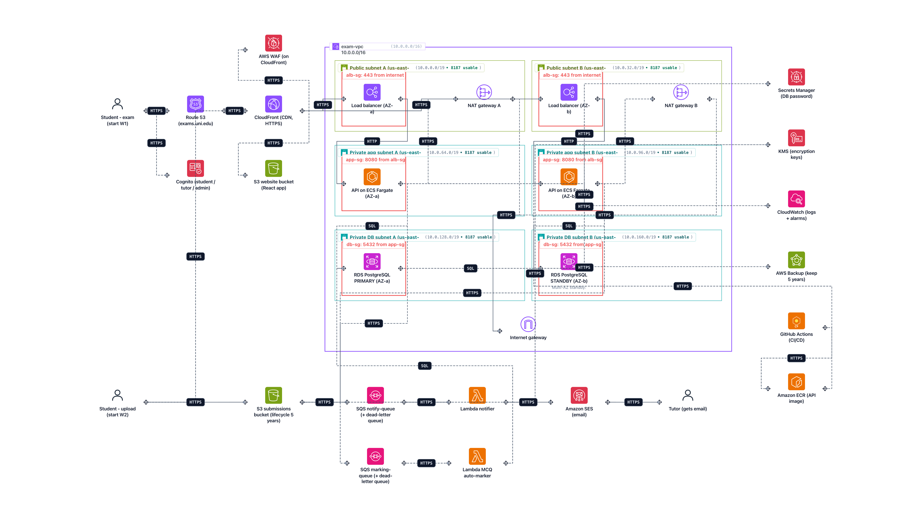
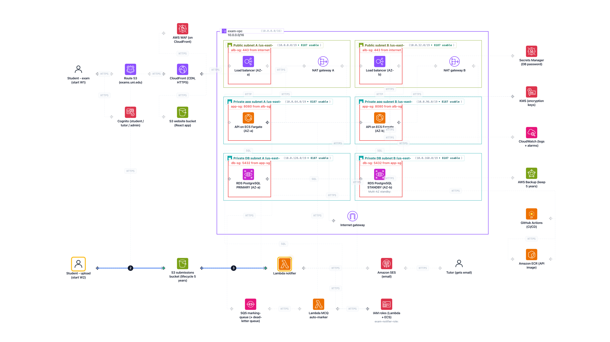

# Request walkthroughs

Both flows follow the components in [`architecture.png`](architecture.png). Each one also has its own diagram.

---

## Walkthrough 1: A student opens an exam and answers autosave

1. **Load the app.** The browser resolves `exams.uni.edu` through **Route 53**, which points to **CloudFront**. **WAF** inspects the request and applies managed rules and per-IP rate limits. CloudFront then serves the React app from the private **S3 frontend bucket** through Origin Access Control, and HTTPS uses an ACM certificate.
2. **Sign in.** The student signs in with **Cognito**. Cognito returns a JWT whose `cognito:groups` claim is `student`, and every API call carries this token.
3. **Open the exam.** `GET /api/exams/{id}/start` goes CloudFront → **ALB** (public subnets, AZ-a and AZ-b) → an **ECS Fargate** task in a private app subnet. The task:
   - verifies the JWT signature and the `student` role;
   - checks that the exam window is open;
   - creates an `attempt` row with a server-side start time, so the timer can't be tampered with in the browser;
   - returns the questions without the MCQ answer key.
4. **Database access.** The task reads and writes through **RDS Proxy**, which pools connections to the **RDS PostgreSQL primary** in AZ-a. The DB password comes from **Secrets Manager**.
5. **Autosave every 30 seconds.** The browser sends `PUT /api/attempts/{id}/answers` with the changed answers only. The API upserts them into the `answers` table, keyed by attempt and question, so a repeated save just overwrites the same row instead of creating a duplicate.
6. **Durability.** RDS Multi-AZ **synchronously** replicates each committed write to the **standby in AZ-b**. A saved answer is therefore never lost, even if AZ-a fails, and the 5-minute RPO is comfortably met. If a save fails, the browser keeps the answers in local storage and retries.
7. **Submit.** When the student submits, or the timer runs out on the server, the API marks the attempt `submitted` and puts a message on the **SQS marking queue**.
8. **Auto-mark.** A **Lambda** auto-marker scores the MCQs against the answer key and stores the scores. Short answers wait for the tutor. When the tutor releases results, a message goes to the **email queue**, and a Lambda sends each student an email through **SES**.

Every step writes logs, metrics and traces to **CloudWatch** and **X-Ray**, and any 5xx errors raise an alarm.

---

## Walkthrough 2: A student uploads a 40 MB assignment and the tutor is notified

1. **Request an upload URL.** The browser sends `POST /api/assignments/{id}/upload-url` with `{type: "application/pdf", size: 41943040}`. The request goes CloudFront → ALB → Fargate.
2. **Validate.** The API checks that:
   - the user is in the `student` group and enrolled in the course;
   - the deadline hasn't passed;
   - the type is PDF or ZIP;
   - the size is no more than 50 MB.

   It then returns an **S3 presigned PUT URL**, valid for 5 minutes and locked to the key `submissions/{course}/{assignment}/{studentId}/{uuid}.pdf` and that content type.
3. **Upload directly to S3.** The browser PUTs the 40 MB file straight to the **S3 submissions bucket**. The file never passes through the ALB or the API, so the API tier isn't tied up by big uploads. The bucket encrypts the object with **SSE-KMS**, keeps versions, and blocks all public access.
4. **Event.** S3 emits an `ObjectCreated` event to the **SQS upload-events queue**. The queue buffers deadline-hour bursts, and failed messages go to a **dead-letter queue**.
5. **Record.** A **Lambda submission recorder** reads the event, checks the object's size and type, and inserts a `submission` row into RDS through RDS Proxy. The row stores the S3 key, the timestamp and an on-time or late flag.
6. **Notify.** The same Lambda sends the tutor an email through **SES**, for example "New submission: Student 02230xxx – Assignment 2". The student gets a receipt email too.
7. **Mark.** Later, the tutor opens the submission. The API returns a short-lived **presigned GET URL**, so the bucket is never made public.
8. **Retention.** Lifecycle rules move the object to **S3 Standard-IA after 90 days** and **Glacier Flexible Retrieval after 1 year**, then **delete it after 5 years**, which meets the records-retention target.
