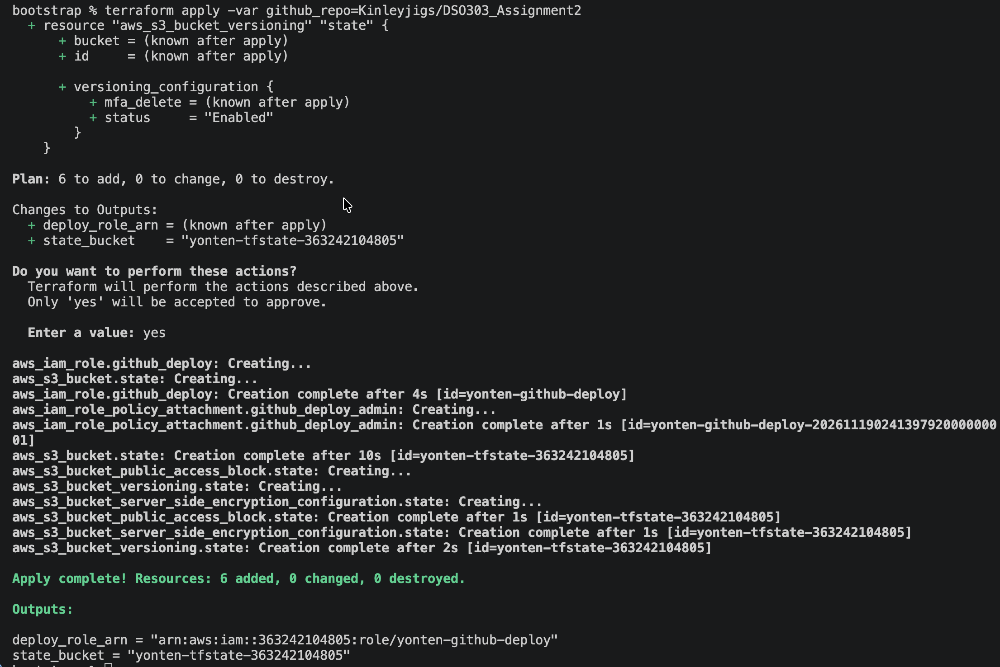
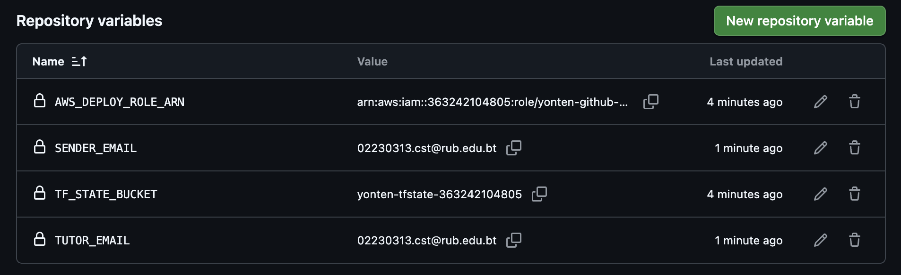
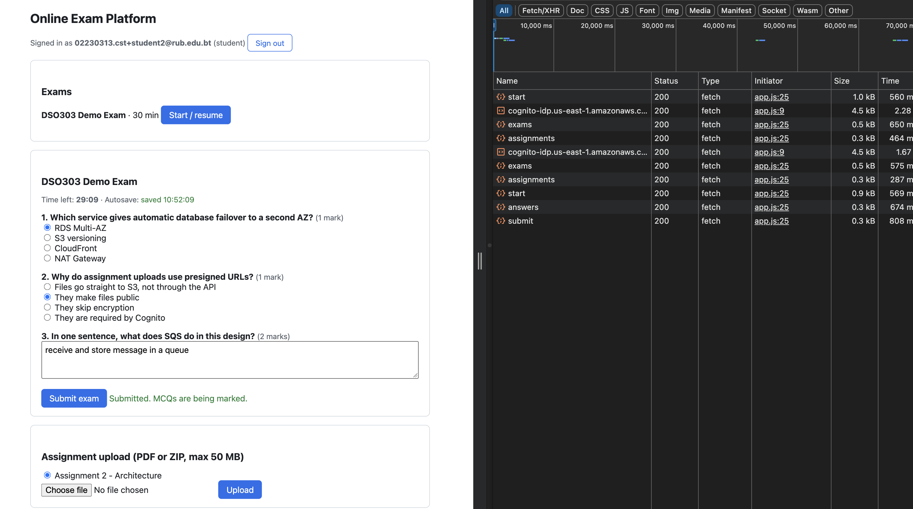
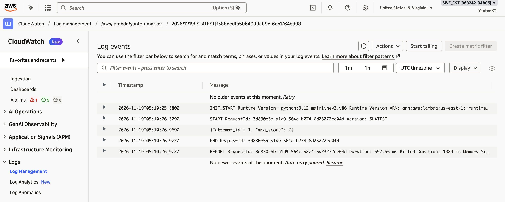
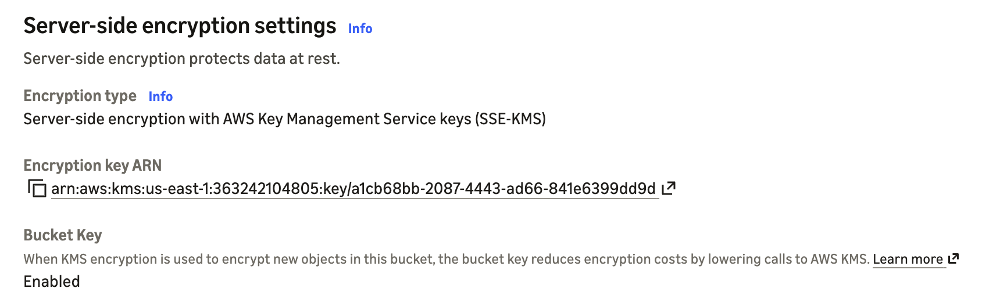
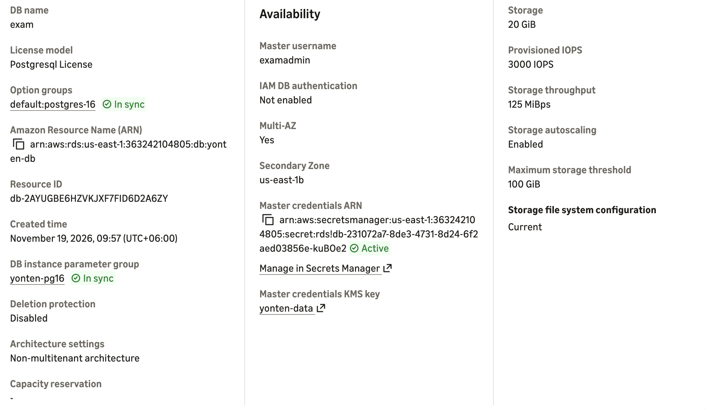
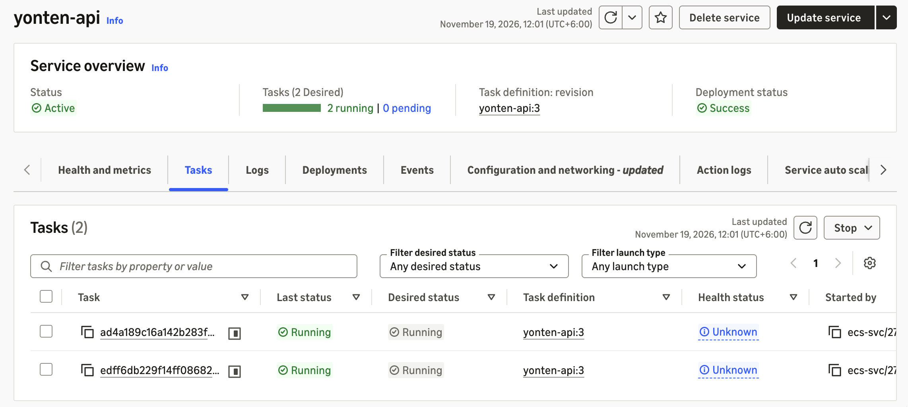
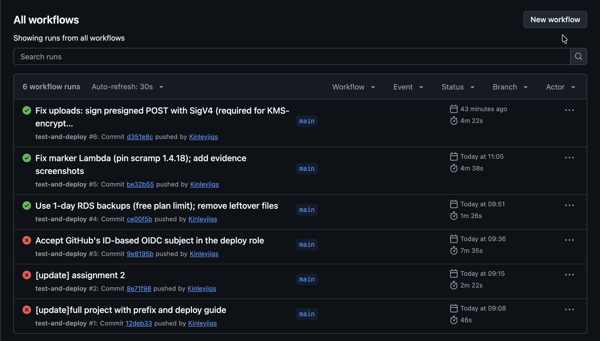

## Deployment evidence (real AWS, us-east-1)

| What it proves | Screenshot |
|---|---|
| Bootstrap: state bucket + GitHub OIDC deploy role |  |
| GitHub repository variables |  |
| Pipeline green after push to `main` |  |
| **Walkthrough 1:** autosave every 30 s (`PUT …/answers` → 200) |  |
| Walkthrough 1: answers locked after submit (server rule) |  |
| Walkthrough 1: marking failed, job kept in the dead-letter queue |  |
| Walkthrough 1: after the fix and redrive, MCQs marked by Lambda |  |
| **Walkthrough 2:** upload rejected before the SigV4 fix (KMS bucket) |  |
| Walkthrough 2: upload succeeded |  |
| Walkthrough 2: file stored in S3 |  |
| Walkthrough 2: file encrypted with KMS |  |
| Walkthrough 2: SES refused unverified addresses (sandbox rule) |  |
| Walkthrough 2: notifier Lambda sent the email |  |
| Walkthrough 2: tutor received "New submission" email |  |
| RDS Multi-AZ + encryption |  |
| ECS tasks running in two AZs |  |
| S3 lifecycle: IA 90 d → Glacier 1 y → delete 5 y |  |
| Six subnets across two AZs |  |
| Every push to `main` redeployed automatically |  |

### Problems found during deployment and how they were fixed

| Problem | Cause | Fix |
|---|---|---|
| GitHub could not assume the AWS role | GitHub now sends an ID-based OIDC subject (`repo:owner@id/repo@id:…`) | Role trust accepts both subject formats, still limited to this repo's `main` branch |
| RDS creation refused | AWS Free plan allows at most 1 day of automated backups | 1-day backups; 5-year retention kept by AWS Backup |
| MCQ marker crashed | `scramp` 1.5.0 removed a function `pg8000` needs | Pinned `scramp==1.4.18`; failed jobs redriven from the DLQ, so no submission was lost |
| Upload rejected by S3 (400) | KMS-encrypted buckets require Signature Version 4 | Presigned POST now signed with SigV4 |
| Tutor email not sent | SES sandbox only sends between verified addresses | Verified sender and tutor addresses |