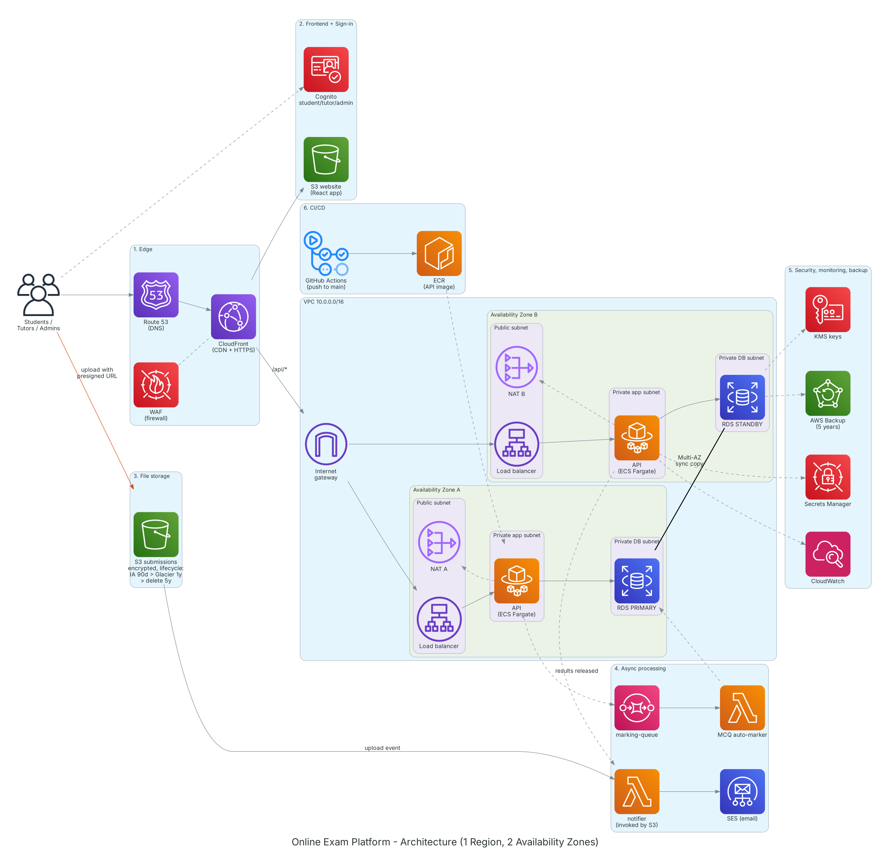

# Online Exam & Assignment Platform on AWS

Assignment 2 – Architecture Design and Deployment (DSO303)

A university with 8,000 students and 400 staff is moving exams and assignment submissions online. This repository contains the full production design and the code that deploys it to AWS:

- timed MCQ and short-answer exams, with answers autosaved every 30 seconds
- MCQ auto-marking, through an SQS queue and a Lambda function
- assignment uploads (PDF or ZIP, up to 50 MB) that go straight to S3, after which the tutor is emailed
- role-based sign-in for students, tutors and admins (Cognito)
- two Availability Zones throughout, so the platform survives the loss of one AZ, with an RPO of about 0 and an RTO of minutes

| Deliverable | Where |
|---|---|
| Architecture diagram, walkthroughs, peak/AZ explanation (Task 1) | [`Architecture_Design/README.md`](Architecture_Design/README.md) |
| Service table (Task 2) | [`Docs/services.md`](Docs/services.md) |
| Cloud Architecture Lab build and simulation (Task 3) | [`cloud-lab/`](cloud-lab/) + screenshots in [`Evidence/`](Evidence/) |
| Infrastructure as Code (Task 3) | [`infra/`](infra/) (Terraform), [`bootstrap/`](bootstrap/) |
| CI/CD pipeline (Task 3) | [`.github/workflows/deploy.yml`](.github/workflows/deploy.yml) |
| Application code | [`app/`](app/) (API), [`lambdas/`](lambdas/), [`frontend/`](frontend/) |



## Repository layout

```
Architecture_Design/ Task 1: diagrams (generated by diagram.py) and the written answer
Docs/services.md     Task 2: every service, why it was chosen, configuration, connections
cloud-lab/           Cloud Architecture Lab workspaces (walkthrough 1 + AZ failure, walkthrough 2)
Evidence/            Screenshots
bootstrap/           One-time setup: Terraform state bucket + GitHub OIDC deploy role
infra/               Terraform for the whole platform (one file per tier)
app/                 Exam API (Python FastAPI, runs on ECS Fargate) + Dockerfile + tests
lambdas/marker/      MCQ auto-marker (triggered by SQS)
lambdas/notifier/    Email notifier (triggered by S3 uploads and by result release)
frontend/            Static web app (served by CloudFront from S3)
scripts/             build_lambdas.sh, create_user.sh, destroy.sh
.github/workflows/   test-and-deploy pipeline
```

## How it deploys

A push to `main` runs this pipeline:

1. **Test:** Python unit tests, then `terraform validate`.
2. **Build:** package the Lambda functions, and build the API Docker image tagged with the commit SHA. The image is pushed to ECR.
3. **Apply:** `terraform apply` creates or updates every resource. A new image tag rolls out a new ECS deployment, which rolls back automatically if the new tasks are unhealthy.
4. **Publish:** upload the frontend to S3, then invalidate the CloudFront cache.
5. **Check:** wait until the ECS service is stable, then print the site URL in the run summary.

GitHub signs in to AWS through **OIDC**, so no AWS keys are stored in GitHub.

---

## Deploy steps

### Prerequisites

| Tool | Version | Used for |
|---|---|---|
| AWS account | – | Admin access for the one-time bootstrap |
| AWS CLI | v2 | Signed in with `aws configure` or `aws sso login` |
| Terraform | 1.10 or newer | Bootstrap and optional local runs |
| Python | 3.12 | Building the Lambda packages and running tests |
| Git + a GitHub repository | – | Your copy of this code |

> **Cost.** Running this platform costs money: two NAT gateways, a Multi-AZ RDS instance, an ALB and Fargate tasks come to roughly US$4–6 per day. Run the [tear-down](#tear-down) as soon as you have your evidence.

### Step 1 – One-time bootstrap: state bucket and deploy role

```bash
cd bootstrap
terraform init
terraform apply -var github_repo=<your-github-user>/<your-repo>
```

Everything is prefixed `yonten`, so it can't clash with other deployments in a shared AWS account. Note the two outputs, `state_bucket` and `deploy_role_arn`.

📸 *Screenshot:* the `Apply complete!` output with the two values.

### Step 2 – Tell GitHub about AWS

In GitHub, go to **Settings → Secrets and variables → Actions → Variables** and add these:

| Variable | Value |
|---|---|
| `AWS_DEPLOY_ROLE_ARN` | `deploy_role_arn` from step 1 |
| `TF_STATE_BUCKET` | `state_bucket` from step 1 |
| `SENDER_EMAIL` | Email the platform sends from (must be one you can open) |
| `TUTOR_EMAIL` | Email that receives "new submission" emails (can be the same as `SENDER_EMAIL`) |
| `ALERT_EMAIL` | *(optional)* Email for CloudWatch alarms |

### Step 3 – Push to `main`

```bash
git add .
git commit -m "Deploy exam platform"
git push origin main
```

Open the **Actions** tab and watch `test-and-deploy`. The first run takes about **20–25 minutes**, mostly creating RDS Multi-AZ and CloudFront.

📸 *Screenshot:* the green pipeline run with both jobs, `test` and `deploy`, plus the site URL in the run summary.

### Step 4 – Confirm the SES emails

AWS SES sends a verification email to `SENDER_EMAIL` and `TUTOR_EMAIL`. **Click both links.** Until you do, SES won't send any emails. New AWS accounts are in the SES *sandbox*, where both sender and receiver must be verified, and this setup verifies both.

### Step 5 – Create users

Run this from the repo root after `terraform -chdir=infra init -backend-config="bucket=<state_bucket>"`:

```bash
./scripts/create_user.sh student1@example.com 'Student12345A' student
./scripts/create_user.sh tutor1@example.com   'Tutor123456A'  tutor
```

### Step 6 – Try both walkthroughs on the real deployment

Open the site URL from the pipeline summary, or run `terraform -chdir=infra output -raw site_url`.

**Walkthrough 1: open an exam and autosave**

1. Sign in as `student1`, then click **Start / resume** on *DSO303 Demo Exam*.
2. Answer a question and wait 30 seconds. The status changes to **"saved hh:mm:ss"**.
3. Click **Submit exam**. The marking job goes to SQS, and the marker Lambda writes the MCQ score.

📸 *Screenshots:*
- the exam page showing "saved …";
- the browser DevTools Network tab showing `PUT /api/attempts/…/answers` returning **200**;
- CloudWatch Logs → `/aws/lambda/yonten-marker` showing `{"attempt_id": …, "mcq_score": …}`.

**Walkthrough 2: upload a 40 MB assignment, tutor notified**

1. Still signed in as the student, choose a PDF under 50 MB and click **Upload**.
2. The page shows *"Uploaded. Your tutor has been notified."*
3. The tutor inbox receives **"New submission for assignment 1"**.

📸 *Screenshots:*
- the upload message on the page;
- the object in the S3 console (`yonten-submissions-…/submissions/1/…`), with *Server-side encryption: AWS-KMS*;
- the tutor's email;
- CloudWatch Logs → `/aws/lambda/yonten-notifier` showing `{'emails_sent': 1}`.

**Optional: the results email.** Sign in as `tutor1` and click **Release results**. Every student who submitted gets an email.

### Step 7 – Show the two-AZ setup and the pipeline redeploy

📸 *Screenshots:*
- **RDS** → `yonten-db`: *Multi-AZ: Yes*, *Encryption: Enabled*, and the primary and secondary AZ;
- **ECS** → `yonten-cluster` → `yonten-api` → Tasks: tasks running in two different AZs;
- **S3** → `yonten-submissions-…` → Management: the lifecycle rule (90 days → IA, 365 → Glacier, 1,825 → delete);
- **Push to main redeploys:** change something small (for example the `<h1>` in `frontend/index.html`), push, and screenshot the new green run plus the updated page.

### Optional: run Terraform from your laptop instead

```bash
./scripts/build_lambdas.sh
cp infra/terraform.tfvars.example infra/terraform.tfvars   # fill in your emails
terraform -chdir=infra init -backend-config="bucket=<state_bucket>"
terraform -chdir=infra apply -target=aws_ecr_repository.api
# build and push app/ to the ECR repo with a tag, then:
terraform -chdir=infra apply -var image_tag=<tag>
```

### Optional: use your own domain (Route 53)

Add `domain_name = "exams.example.com"` and `hosted_zone_id = "Z…"` to the variables. Terraform then creates an ACM certificate, validates it through Route 53, attaches it to CloudFront and creates the `A`/`AAAA` alias records.

---

## Tear-down

Destroy everything as soon as you have your evidence. The buckets, ECR images and backup vault are emptied automatically.

```bash
terraform -chdir=infra init -backend-config="bucket=<state_bucket>"   # if not already done
./scripts/destroy.sh -var sender_email=<same as deploy> -var tutor_email=<same as deploy>
```

If you also want to remove the state bucket and deploy role:

```bash
cd bootstrap
terraform destroy -var github_repo=<your-github-user>/<your-repo>
```

📸 *Screenshot:* `Destroy complete!`

Notes:
- The KMS key is scheduled for deletion after 7 days. This is AWS's minimum waiting period, and the key costs nothing while it waits.
- If `destroy` stops on the backup vault because a backup job is still running, wait a few minutes and run it again.

---

## Design notes (known trade-offs)

| Choice | Why, and what production would do differently |
|---|---|
| CloudFront → ALB traffic uses HTTP | It stays on the AWS network. The ALB accepts only CloudFront's IP ranges plus a secret header. With a custom domain, add an HTTPS listener on the ALB for end-to-end TLS. |
| The deploy role has AdministratorAccess | Terraform must create IAM, VPC and RDS resources. In production, scope it down and add a permissions boundary. |
| `db.t4g.micro`, 2 API tasks normally | Keeps the demo cheap. Production uses `db.t4g.medium`. Scheduled scaling raises the API to 8+ tasks before each exam. |
| Tutor address set in one variable | Keeps the demo simple. Production would look up the course's tutor in the database. |

## Running the tests locally

```bash
pip install -r app/requirements.txt -r app/requirements-dev.txt -r lambdas/marker/requirements.txt
pytest -q
```
