# Online Exam & Assignment Platform on AWS

### Assignment 2: Architecture Design and Deployment (DSO303)

## 1. Summary

For this assignment I designed and deployed an online exam and assignment submission platform for a university with 8,000 students and 400 staff. The platform supports:

- timed MCQ and short-answer exams, with answers autosaved every 30 seconds
- MCQ auto-marking, through an SQS queue and a Lambda function
- assignment uploads (PDF or ZIP, up to 50 MB) that go straight to S3, after which the tutor is emailed
- role-based sign-in for students, tutors and admins (Cognito)
- two Availability Zones throughout, so the platform survives the loss of one AZ, with an RPO of about 0 and an RTO of minutes

I first designed and simulated the architecture in the Cloud Architecture Lab. I then built the whole platform as Infrastructure as Code with Terraform, deployed it to AWS (`us-east-1`) through a GitHub Actions pipeline, and tested both walkthroughs on the live system. When I had collected my evidence, I tore everything down to stop the costs.

| Deliverable | Where |
|---|---|
| Architecture design, walkthroughs, peak/AZ explanation (Task 1) | [`Architecture_Design/README.md`](Architecture_Design/README.md) |
| Service table (Task 2) | [`Docs/services.md`](Docs/services.md) |
| Cloud Architecture Lab build and simulation (Task 3) | [`Architecture_Design/cloud-lab/`](Architecture_Design/cloud-lab/) + screenshots in [`Evidence/`](Evidence/) |
| Infrastructure as Code (Task 3) | [`infra/`](infra/) (Terraform), [`bootstrap/`](bootstrap/) |
| CI/CD pipeline (Task 3) | [`.github/workflows/deploy.yml`](.github/workflows/deploy.yml) |
| Application code | [`app/`](app/) (API), [`lambdas/`](lambdas/), [`frontend/`](frontend/) |

## 2. Repository layout

```
Architecture_Design/ Task 1: written design, walkthroughs and peak/AZ answer
  cloud-lab/         Cloud Architecture Lab workspaces (walkthrough 1 + AZ failure, walkthrough 2)
Docs/services.md     Task 2: every service, why I chose it, configuration, connections
Evidence/            Screenshots
bootstrap/           One-time setup: Terraform state bucket + GitHub OIDC deploy role
infra/               Terraform for the whole platform (one file per tier)
app/                 Exam API (Python FastAPI, runs on ECS Fargate) + Dockerfile + tests
lambdas/marker/      MCQ auto-marker (triggered by SQS)
lambdas/notifier/    Email notifier (triggered by S3 uploads and by result release)
frontend/            Static web app (served by CloudFront from S3)
scripts/             build_lambdas.sh, create_user.sh, destroy.sh
.github/workflows/   test-and-deploy pipeline
```

## 3. CI/CD pipeline

I set up the pipeline so that every push to `main` runs these stages:

1. **Test:** Python unit tests, then `terraform validate`.
2. **Build:** package the Lambda functions, and build the API Docker image tagged with the commit SHA. The image is pushed to ECR.
3. **Apply:** `terraform apply` creates or updates every resource. A new image tag rolls out a new ECS deployment, which rolls back automatically if the new tasks are unhealthy.
4. **Publish:** upload the frontend to S3, then invalidate the CloudFront cache.
5. **Check:** wait until the ECS service is stable, then print the site URL in the run summary.

GitHub signs in to AWS through **OIDC**, so I did not store any AWS keys in GitHub.

---

## 4. Cloud Architecture Lab (Task 3)

I built the full architecture in the Cloud Architecture Lab and ran both walkthroughs as simulations. The workspaces are in [`Architecture_Design/cloud-lab/`](Architecture_Design/cloud-lab/): `assignment2.json` for walkthrough 1 and the AZ failure, and `assignment2-upload.json` for walkthrough 2.


*Figure 1: Full production architecture built in the Cloud Architecture Lab*


*Figure 2: Walkthrough 1 exam request path on the Lab canvas*


*Figure 3: Walkthrough 1 decision trace, Route 53 → CloudFront → Load balancer → API (ECS) → RDS, ending in SUCCESS*

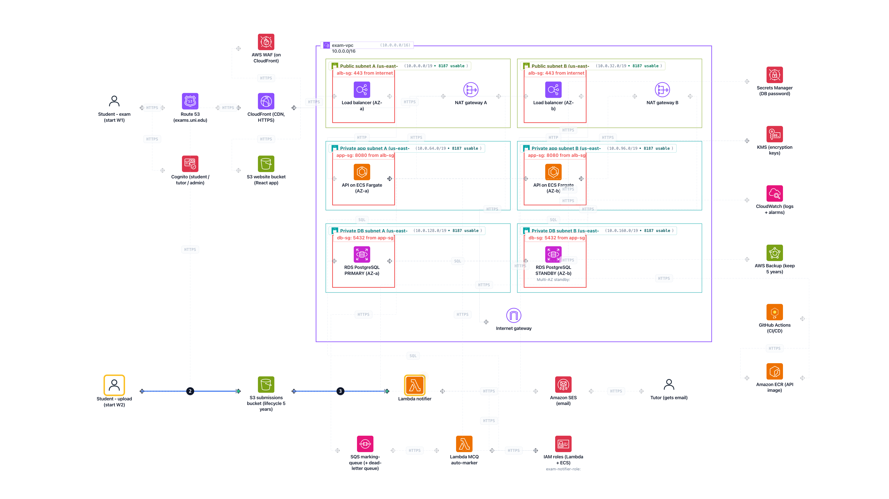

*Figure 4: Walkthrough 2 upload path on the Lab canvas*

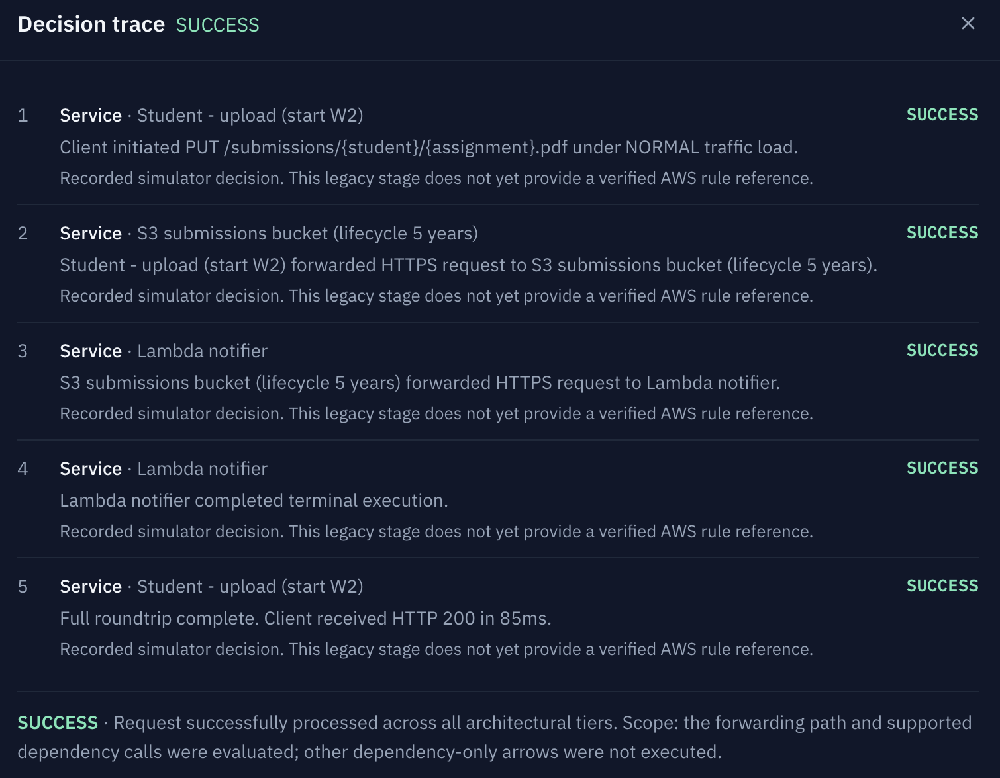

*Figure 5: Walkthrough 2 decision trace, Student → S3 → Lambda notifier, ending in SUCCESS*

---

## 5. How I deployed it to AWS

I deployed everything in `us-east-1`. The AWS account was shared with classmates, so I prefixed every resource with `yonten` to keep my resources separate from theirs.

### Tools I used

| Tool | Version | Used for |
|---|---|---|
| AWS CLI | v2 | Signed in as my IAM user |
| Terraform | 1.10 or newer | Bootstrap and the platform |
| Python | 3.12 | Building the Lambda packages and running tests |
| Git + GitHub | – | Source code and GitHub Actions |

Running the platform cost roughly US$4–6 per day, mainly for the two NAT gateways, the Multi-AZ RDS instance, the load balancer and the Fargate tasks.

### Step 1: Bootstrap the state bucket and deploy role

I created the Terraform state bucket and the GitHub OIDC deploy role once, from my laptop:

```bash
cd bootstrap
terraform init
terraform apply -var github_repo=Kinleyjigs/DSO303_Assignment2
```

This gave me two outputs, `state_bucket` and `deploy_role_arn`.


*Figure 6: Bootstrap Terraform state bucket and GitHub OIDC deploy role created*

### Step 2: Connect GitHub to AWS

In GitHub (**Settings → Secrets and variables → Actions → Variables**) I added these variables:

| Variable | Value |
|---|---|
| `AWS_DEPLOY_ROLE_ARN` | `deploy_role_arn` from step 1 |
| `TF_STATE_BUCKET` | `state_bucket` from step 1 |
| `SENDER_EMAIL` | Email address the platform sends from |
| `TUTOR_EMAIL` | Email address that receives "new submission" emails |


*Figure 7: GitHub repository variables used by the pipeline*

### Step 3: Push to `main`

I pushed the code to `main`, which started the `test-and-deploy` pipeline. The first run took about 20–25 minutes, mostly creating RDS Multi-AZ and CloudFront. Both jobs, `test` and `deploy`, passed, and the site URL appeared in the run summary.

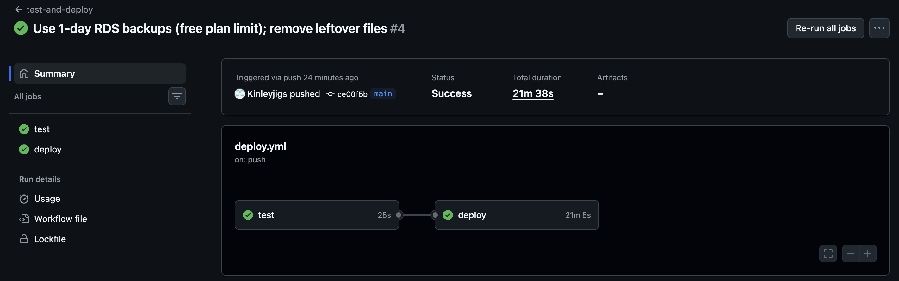

*Figure 8: Pipeline green after a push to `main` (test and deploy jobs)*

### Step 4: Confirm the SES emails and create users

SES sent a verification email to the sender and tutor addresses, and I confirmed both. My AWS account was in the SES *sandbox*, where both sender and receiver must be verified. I then created a student and a tutor account:

```bash
terraform -chdir=infra init -backend-config="bucket=<state_bucket>"
./scripts/create_user.sh student1@example.com 'Student12345A' student
./scripts/create_user.sh tutor1@example.com   'Tutor123456A'  tutor
```

### Step 5: Test walkthrough 1: open an exam and autosave

1. I signed in as `student1` and clicked **Start / resume** on *DSO303 Demo Exam*.
2. I answered a question and waited 30 seconds. The status changed to **"saved hh:mm:ss"**, and `PUT /api/attempts/…/answers` returned **200**.
3. I clicked **Submit exam**. After that the API refused any further changes to the answers. The marking job went to SQS, and the marker Lambda wrote the MCQ score.


*Figure 9: Walkthrough 1: answers autosaved every 30 seconds (`PUT …/answers` returns 200)*

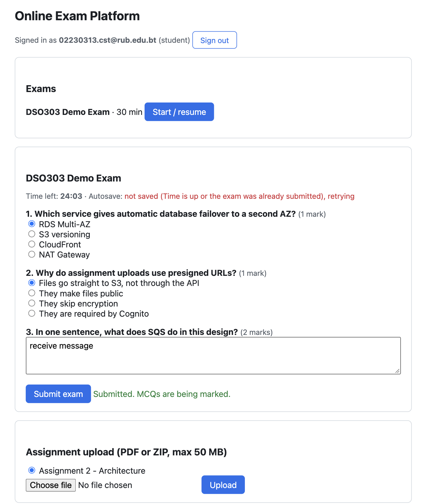

*Figure 10: Walkthrough 1: answers locked after submit (rule enforced on the server)*


*Figure 11: Walkthrough 1: marker Lambda log showing the MCQ score (after the fix, failed jobs redriven from the DLQ)*

### Step 6: Test walkthrough 2: upload an assignment and notify the tutor

1. Signed in as the student, I chose a PDF under 50 MB and clicked **Upload**. My first attempt was rejected by S3 (Figure 12). I fixed this by signing the presigned POST with SigV4 (see section 6).
2. After the fix, the page showed *"Uploaded. Your tutor has been notified."*
3. The file was stored in `yonten-submissions-…/submissions/1/…` and encrypted with AWS KMS.
4. The notifier Lambda logged `{'emails_sent': 1}`, and the tutor inbox received **"New submission for assignment 1"**.

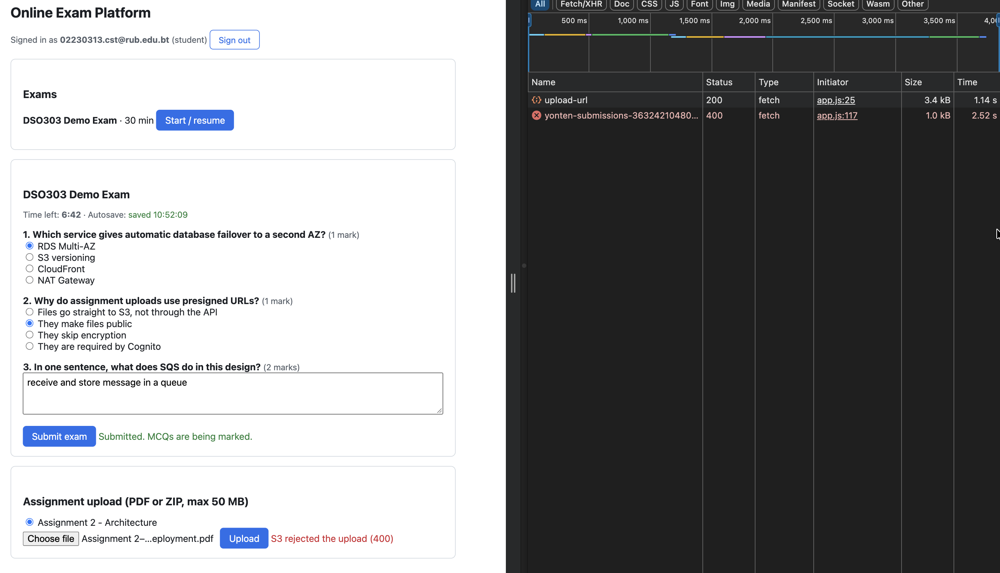

*Figure 12: Walkthrough 2: upload rejected by S3 before the SigV4 fix (KMS-encrypted bucket)*

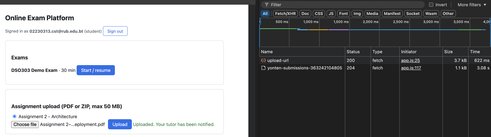

*Figure 13: Walkthrough 2: upload succeeded after the fix*

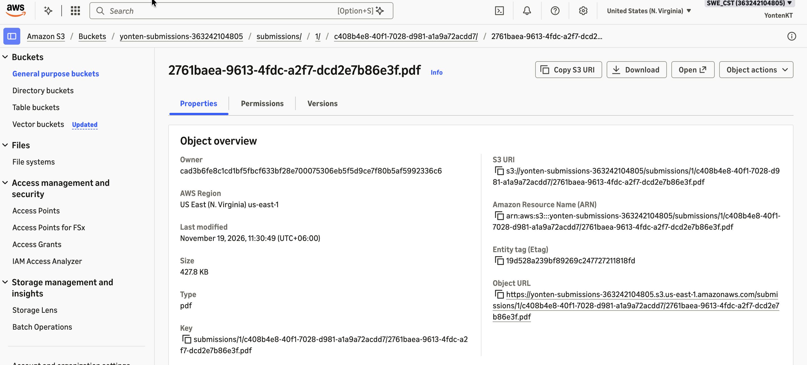

*Figure 14: Walkthrough 2: submitted file stored in the S3 submissions bucket*


*Figure 15: Walkthrough 2: file encrypted at rest with AWS KMS*

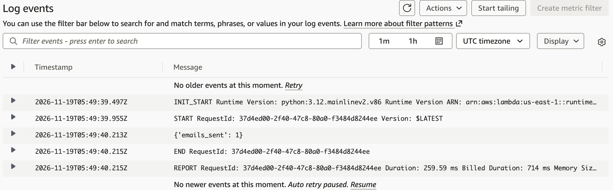

*Figure 16: Walkthrough 2: notifier Lambda log showing the email was sent*

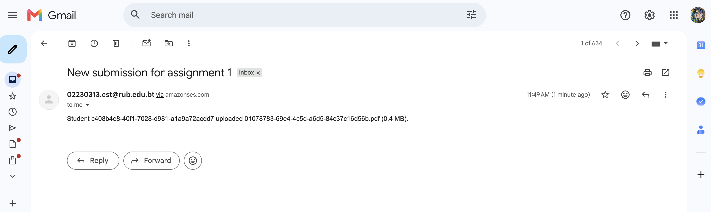

*Figure 17: Walkthrough 2: tutor received the "New submission" email*

### Step 7: Check the two-AZ setup, storage lifecycle and redeploy

I checked in the AWS console that:
- RDS `yonten-db` had *Multi-AZ: Yes* and *Encryption: Enabled*;
- the ECS service `yonten-api` had tasks running in two different AZs;
- the submissions bucket had the lifecycle rule (90 days → IA, 365 → Glacier, 1,825 → delete);
- the VPC had six subnets across two AZs.

To prove that a push to `main` redeploys the platform, I changed the page title in `frontend/index.html` and pushed. A new green run started automatically and updated the live site.


*Figure 18: RDS PostgreSQL Multi-AZ enabled, storage encrypted*


*Figure 19: ECS Fargate API tasks running in two Availability Zones*

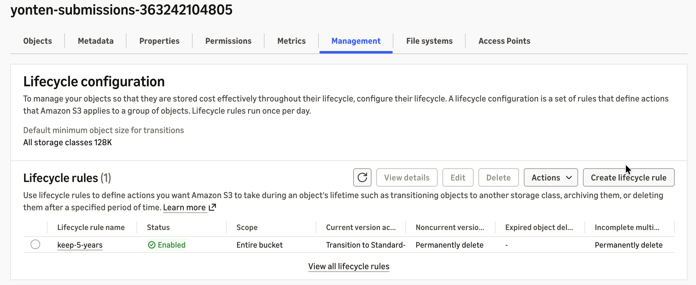

*Figure 20: S3 lifecycle rule Standard-IA after 90 days, Glacier after 1 year, delete after 5 years*

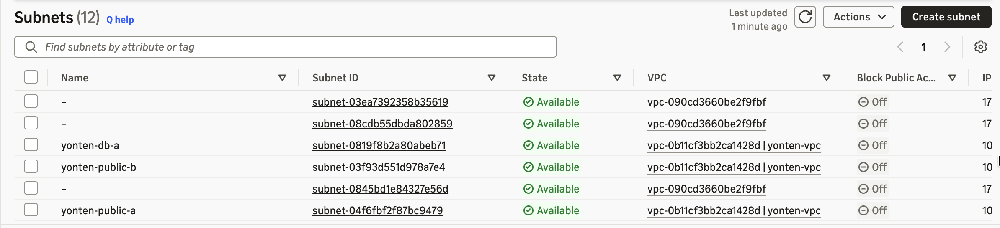

*Figure 21: VPC six subnets (public, private-app, private-DB) across two AZs*


*Figure 22: Every push to `main` redeployed the platform automatically*

---

## 6. Problems I found during deployment and how I fixed them

| Problem | Cause | How I fixed it |
|---|---|---|
| GitHub could not assume the AWS role | GitHub now sends an ID-based OIDC subject (`repo:owner@id/repo@id:…`) | I changed the role trust to accept both subject formats, still limited to this repo's `main` branch |
| RDS creation refused | The AWS Free plan allows at most 1 day of automated backups | I set 1-day automated backups and kept the 5-year retention with AWS Backup |
| MCQ marker crashed | `scramp` 1.5.0 removed a function that `pg8000` needs | I pinned `scramp==1.4.18` and redrove the failed jobs from the dead-letter queue, so no submission was lost |
| Upload rejected by S3 (400) | KMS-encrypted buckets require Signature Version 4 | I signed the presigned POST with SigV4 |
| Tutor email not sent | The SES sandbox only sends between verified addresses | I verified both the sender and the tutor addresses |

---

## 7. Tear-down

After collecting my evidence, I disabled the GitHub workflow so that later pushes would not rebuild the platform. Then I destroyed everything with Terraform. The buckets, ECR images and backup vault are emptied automatically before deletion.

```bash
terraform -chdir=infra init -backend-config="bucket=<state_bucket>"
./scripts/destroy.sh -var sender_email=<sender email> -var tutor_email=<tutor email>

cd bootstrap
terraform destroy -var github_repo=Kinleyjigs/DSO303_Assignment2
```

Before confirming, I checked the destroy plan to make sure it only contained my own `yonten-` resources, because the account was shared.

The KMS key is scheduled for deletion after 7 days. This is the minimum waiting period AWS allows, and the key costs nothing while it waits.

---

## 8. Design trade-offs

| Choice | Why I made it, and what I would do in production |
|---|---|
| CloudFront → ALB traffic uses HTTP | It stays on the AWS network, and the ALB accepts only CloudFront's IP ranges plus a secret header. With a custom domain, I would add an HTTPS listener on the ALB for end-to-end TLS. |
| The deploy role has AdministratorAccess | Terraform must create IAM, VPC and RDS resources. In production I would scope it down and add a permissions boundary. |
| `db.t4g.micro`, 2 API tasks normally | This kept the demo cheap. In production I would use `db.t4g.medium`, and scheduled scaling would raise the API to 8+ tasks before each exam. |
| Tutor address set in one variable | This kept the demo simple. In production the tutor would be looked up from the course in the database. |

The Terraform also supports a custom domain. With `domain_name` and `hosted_zone_id` set, it creates an ACM certificate, validates it through Route 53, attaches it to CloudFront and creates the alias records. I didn't use this, because I had no domain for the demo.

## 9. Running the tests

```bash
pip install -r app/requirements.txt -r app/requirements-dev.txt -r lambdas/marker/requirements.txt
pytest -q
```
